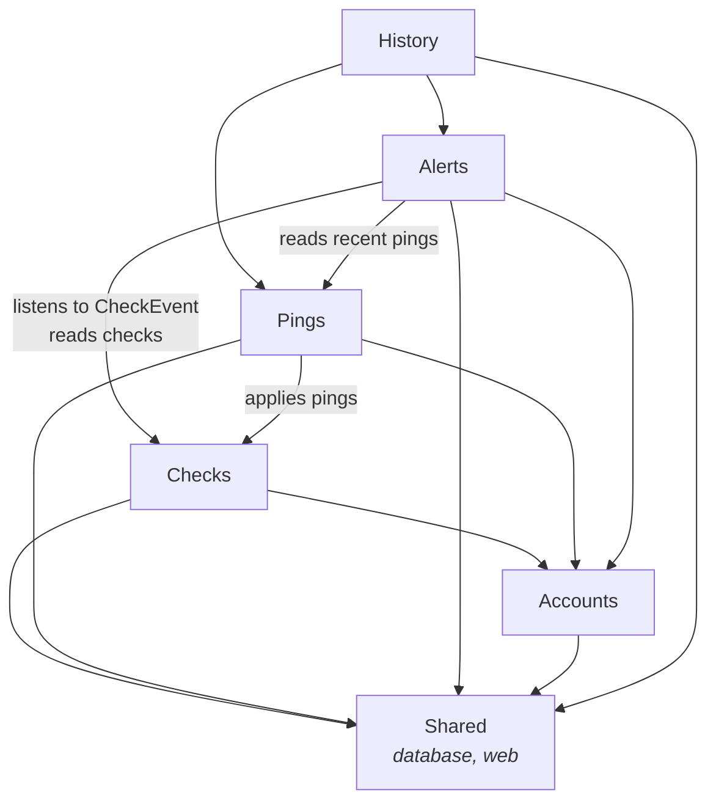
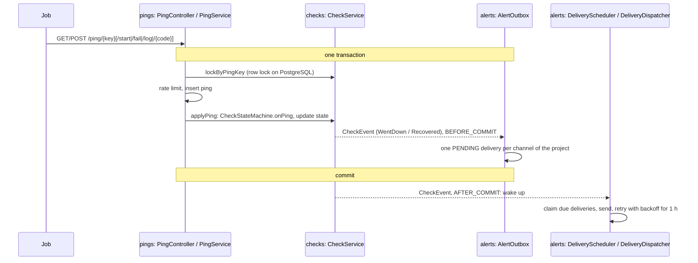

# Architecture

How the Cronbell server is built, and where new code goes. What Cronbell does is specified in
[`DESIGN.md`](DESIGN.md); this document is about the code in [`server/`](server). The web
dashboard in [`web/`](web) is a separate single-page app that only talks to the HTTP API.

## Purpose and shape

The server is one Spring Boot application, deployed as one process (one container), on SQLite or
PostgreSQL. Inside, it is a **modular monolith**: the code is split into application modules with
explicit APIs and declared dependencies, verified on every build by
[Spring Modulith](https://spring.io/projects/spring-modulith). This keeps the operational simplicity
of a single deployable (one image, one database, transactions across modules) while making the
boundaries as hard to cross by accident as separate services would.

Each direct sub-package of `com.steelreed.cronbell.server` is a module:

| Module | Package | Owns |
|---|---|---|
| Checks | `checks` | Checks and their schedules (cron with time zones, periods), the state machine (DESIGN.md §3, §4), the detector, `CheckEvent` |
| Pings | `pings` | The `/ping` endpoint (Healthchecks.io compatible), its rate limit, ping storage, the recent pings of a check |
| Alerts | `alerts` | Channels (email, Telegram, Slack, webhooks), the delivery outbox, the dispatcher and retries, message rendering per channel type |
| Accounts | `accounts` | Accounts and setup, projects and memberships, API keys, sessions, the security filter chain |
| History | `history` | Daily pruning of old pings and finished deliveries |
| Shared | `shared` | Database support and web plumbing that every module uses and that depends on no module |

The names are the nouns the specification and the API use (`/api/v1/checks`, `/ping`, alert
channels, accounts), in the plural like the REST resources. `alerts` replaces the old `notify`
package because alerts are what the module owns; delivering them is one of its jobs. `shared`
was preferred to `infrastructure` because it is defined by who uses it (everyone), and it holds web
error handling and the SPA route too, which are not infrastructure in the usual sense.

## Module map

The graph below is the one `ModularityTests` verifies (arrows point to what a module uses). It has
no cycles, and a module may only use the modules listed in its `package-info.java`.



The dependencies on `accounts` are only for `ProjectPrincipal`, the caller that every controller of
the management API acts for. Spring Modulith also writes C4 component diagrams and a canvas per
module (beans, events, configuration properties) when the tests run; a copy is kept in
[`docs/architecture`](docs/architecture).

## Inside a module

```
checks/
├── package-info.java        @ApplicationModule: display name, allowed dependencies
├── Check.java, CheckEvent.java, CheckService.java, ...   the API (what other modules may use)
├── internal/                everything else: repositories, jobs, listeners
│   └── domain/              the pure core: state machine, schedules
└── web/                     controllers of this module (and its exception handler)
```

- **Top-level package = API.** Only public types directly in the module package can be used by
  other modules. Keep it small: value types (records, enums, sealed event types) and one service
  facade. `shared` exposes two named interfaces instead (`shared.database`, `shared.web`, declared
  with `@NamedInterface`); `shared.internal` is private to it.
- **`internal`** holds the rest. Types there are `public` only when another package of the same
  module (or a test) needs them; otherwise they are package-private.
- **`web`** holds the controllers. A controller of the management API is annotated
  `@ManagementApi`, which makes it answer errors as RFC 9457 problem details: `shared.web` handles
  `IllegalArgumentException` (400), any `NotFoundException` (404) and concurrent-write conflicts
  (409); a module adds a `@RestControllerAdvice(annotations = ManagementApi.class)` for errors only
  it raises (for example `AccountsExceptionHandler` for 401/409/429 of sign-in and setup).

Public APIs per module:

| Module | API |
|---|---|
| Checks | `Check`, `CheckState`, `CheckStatus`, `DownReason`, `PingKind`, `ScheduleKind`, `CheckEvent`, `CheckNotFoundException`, `CheckService` |
| Pings | `Ping`, `PingHistory` |
| Alerts | `DeliveryHistory` |
| Accounts | `ProjectPrincipal` |
| History | none |
| Shared | `database`: `Database`, `Ids`, `JobLocks`; `web`: `ManagementApi`, `NotFoundException` |

## Main flows

### A ping, a status change, an alert



1. `PingController` parses the request; `PingService` runs in one transaction: it locks the check
   through `CheckService.lockByPingKey`, applies the rate limit, stores the ping and calls
   `CheckService.applyPing`.
2. `applyPing` runs the pure `CheckStateMachine.onPing`, stores the new state if it changed, and
   publishes a `CheckEvent` when the check went DOWN or came back UP.
3. `AlertOutbox` listens in the `BEFORE_COMMIT` phase and inserts one `deliveries` row per channel
   of the project. The outbox rows commit with the state change or not at all.
4. After commit, `DeliveryScheduler` wakes the dispatcher (it also runs every 5 s), which claims
   due rows (`FOR UPDATE SKIP LOCKED` on PostgreSQL), sends them on virtual threads and records the
   result, retrying for an hour. `CheckEventLogger` logs the change.

### The detector: MISSED and RUNNING_TOO_LONG

Every 15 s `checks.internal.Detector` claims UP checks that are overdue in batches of 100, runs
`CheckStateMachine.detect` on each, stores the DOWN state and publishes `CheckEvent.WentDown`. From
there the alert path is the same as for a ping.

### History pruning

Once a day (and a minute after start) `history.internal.HistoryPruner` takes the `history-pruning`
lease in `job_locks`, then deletes in batches through `PingHistory.deleteBefore` and
`DeliveryHistory.deleteFinishedBefore`, renewing the lease between batches.

### Events and listeners

`CheckEvent` is the only event between modules. Its listeners are plain
`@TransactionalEventListener`s, not Spring Modulith's `@ApplicationModuleListener`, on purpose:

| Listener | Phase | Why |
|---|---|---|
| `alerts.internal.AlertOutbox` | `BEFORE_COMMIT`, same transaction | The outbox guarantee: deliveries are written atomically with the status change. `@ApplicationModuleListener` is asynchronous, after commit and in a new transaction, so a crash between the two commits would lose the alert. |
| `alerts.internal.DeliveryScheduler` | `AFTER_COMMIT`, synchronous | Only queues a dispatcher run on its own executor; a new transaction or an event publication registry would add nothing. |
| `checks.internal.CheckEventLogger` | `AFTER_COMMIT`, synchronous | Logs committed changes only. |

The outbox already gives at-least-once delivery, so Spring Modulith's event publication registry
is not used.

## Data model

One Flyway schema ([`server/src/main/resources/db/migration`](server/src/main/resources/db/migration))
runs on SQLite and PostgreSQL. Each table is written by one module only; other modules go through
its API, never its tables.

| Module | Tables |
|---|---|
| Accounts | `projects`, `api_keys` (SHA-256 hashes), `accounts`, `project_members` |
| Checks | `checks` (definition and current state: status, last ping, next due, open run) |
| Pings | `pings` |
| Alerts | `channels` (config as JSON), `deliveries` (the outbox; the alert as a JSON payload) |
| Shared | `job_locks` (leases for jobs run by one instance at a time) |

Foreign keys cascade from `projects` and `checks`, so deleting a check deletes its pings and
deliveries in the database. Ids are UUIDv7 strings made by `shared.database.Ids`; times are epoch
milliseconds. `PingHistory.deleteBefore` reads `checks.run_started_at` in SQL to keep the pings of
an open run: the one place a query looks at another module's table, kept because it has to be one
statement.

## Adding a feature

1. **Specify it** in `DESIGN.md` if behaviour changes.
2. **Pick the module** that owns the data or the concept. A new kind of alert channel belongs in
   `alerts`; a new check property in `checks`. A new module is warranted only for a new area with
   its own data (for example status pages), with a `package-info.java` listing what it may use.
3. **Keep the API small.** Put new types in `internal` (or `web` for controllers) first; move a type
   to the module package only when another module needs it. Cross-module calls go through the API;
   reactions to something another module did go through an event of that module.
4. **Test** at the right level: pure logic with plain unit tests next to it (see
   `CheckStateMachineTests`), HTTP behaviour in `AbstractIntegrationTests`, which runs on SQLite and
   PostgreSQL. `ModularityTests` and `ArchitectureTests` fail if a boundary is crossed.

## Conventions

- Java 25 and Spring Boot 4.1, every dependency on its latest stable release.
- Records for value types and DTOs; sealed interfaces with pattern-matching `switch` for closed sets
  of variants (`CheckEvent`, `Schedule`, `ChannelSender`); enums for persisted kinds
  (`CheckStatus`, `DownReason`, `PingKind`, `ChannelType`).
- Constructor injection only, `final` fields, `Optional` only as a return type, `java.time` only.
- SQL through `JdbcClient`; multi-line SQL as text blocks. Portable SQL only: `VARCHAR`, `TEXT`,
  `INTEGER`, `BIGINT`, with the SQLite/PostgreSQL differences in `Database`.
- All time comes from the `Clock` bean, so tests can move it.
- Spring Java Format (`make format`); the build fails on unformatted code. Deprecated APIs are
  reported by the compiler (`-Xlint:deprecation`) and fixed.
- Commits are signed off for the DCO (`git commit -s`), see [CONTRIBUTING.md](CONTRIBUTING.md).

## How the rules are enforced

Both run in `./mvnw verify` (and `make test`, and CI):

- **`ModularityTests`** (Spring Modulith): `ApplicationModules.of(CronbellApplication.class).verify()`
  fails on a cycle between modules, on a dependency not listed in `allowedDependencies`, or on use
  of a type outside a module's API. It also writes the documentation in
  `server/target/spring-modulith-docs`.
- **`ArchitectureTests`** (ArchUnit) covers what module boundaries do not:
  - `checks.internal.domain` and the check model depend only on the JDK (and on Spring's
    `CronExpression`, the cron parser; rewriting it is not worth the risk);
  - controllers and controller advice live in `web` packages;
  - no field injection; no `java.util.Date`, `Calendar` or `java.sql` date-time types; no
    `System.out` or `java.util.logging`.

To refresh the diagrams in `docs/architecture` after changing the structure, run the tests and copy
the files:

```bash
cd server && ./mvnw -B test -Dtest=ModularityTests
cp target/spring-modulith-docs/*.puml target/spring-modulith-docs/*.adoc ../docs/architecture/
```

and update the Mermaid graph above if a dependency changed.
